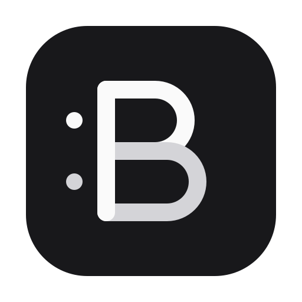

# Bicord

**只专注一件事。把你听到的和你说的录在一起。**

Bicord 是一款 macOS 录音应用，同时录制系统声音和麦克风，保存为一份本地 M4A 文件。

[下载 Bicord](https://github.com/import-ai/bicord/actions/workflows/build.yml?query=branch%3Amain+is%3Asuccess)

## 录音前，一眼确认两路声音

- **自己选音源。** 系统声音和麦克风各有开关，两路都开可以同时录制，只开一路也可以录。
- **看得见声音。** 两路实时电平分别显示，方便确认系统声音和麦克风有没有收到信号。
- **换耳机，接着录。** Bicord 跟随 macOS 当前的输入和输出设备，录音中切换设备后，声音仍会录进同一个文件。设备重新连接时可能短暂静音。
- **录音留在 Mac 上。** 默认保存到 `~/bicord`，也可以选自己的文件夹。录完可以在列表里播放，或直接在 Finder 中找到。

## 安装

需要 macOS 14.2 或更新版本。登录 GitHub，打开[最新一条成功的构建](https://github.com/import-ai/bicord/actions/workflows/build.yml?query=branch%3Amain+is%3Asuccess)，在页面底部的 **Artifacts** 下载适合你 Mac 的安装包。

| 你的 Mac | 选择的安装包 |
| --- | --- |
| Apple 芯片 | `-arm64.dmg` |
| Intel 芯片 | `-amd64.dmg` |

打开 DMG，把 Bicord 拖到「应用程序」。安装包已签名并通过 Apple 公证。

## 开始录音

1. 打开 Bicord，选择音源。系统声音和麦克风默认开启。
2. 点击「开始录音」。首次录制时，按 macOS 提示允许访问你选用的音源。
3. 点击「停止并保存」。录音会出现在文件列表里，可随时播放或在 Finder 中打开。
